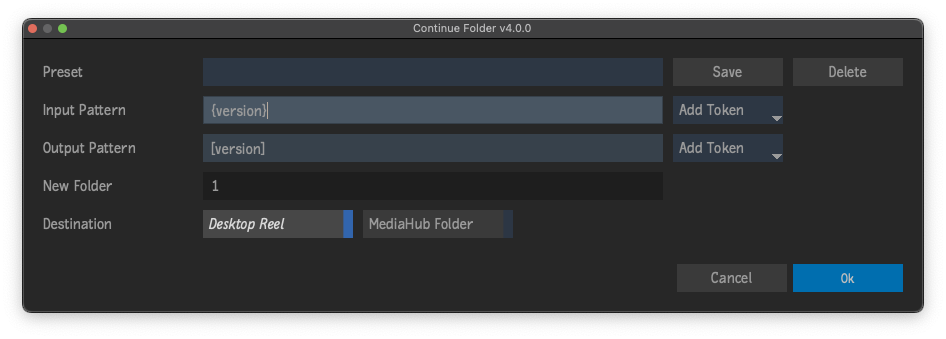

# Continue Folder

Plugin for [Autodesk Flame software](http://www.autodesk.com/products/flame).

Create a new reel on the Desktop and/or a system folder in MediaHub Files using tokens.



## Tokens
**Input Pattern** uses curly braces to interpret existing destination folders.
**Output Pattern** uses square brackets to form the new folder name.

**Input**:
- `{PP}` / `{pp}` — AM/PM
- `{DD}` — Day
- `{hh}` / `{HH}` — Hour (12hr / 24hr)
- `{mm}` — Minute
- `{MM}` — Month
- `{YY}` / `{YYYY}` — Year
- `{version}` — Scan matching folders and continue the number sequence (*similar* to the version token for pattern browsing).

**Output**:
- `[PP]` / `[pp]` — AM/PM
- `[DD]` — Day
- `[hh]` / `[HH]` — Hour (12hr / 24hr)
- `[mm]` — Minute
- `[MM]` — Month
- `[YY]` / `[YYYY]` — Year
- `[version]` — Next version from the input pattern scan. Optional hashes set zero-padding: `[version###]`.

## Example
Input `{YYYY}_{MM}_v{version}` + Output `[YYYY]_[MM]_v[version###]` → `2026_08_v004`

## Example Workflow
Say you want to have a Library that will mirror a folder of exports on the server.  The system folder of exports looks like below:
```
/exports
├── test_v001
├── test_v002
└── test_v003
```

 1. Navigate to the filesystem folder (`exports/` in the above example)
 2. Select the folder (`exports/` in the above example) `->` right click `->` Create... `->` Continue Folder
 3. Set the Input Pattern to `test_v{version}`
 4. Set the Output Pattern to `test_v[version###]`
 5. Set the Destination to Desktop Reel
 6. Press OK.  A new reel named `test_v004` will be created
 7. Copy the timelines you want to export into this new reel
 8. Drag the reel to the server folder to export
 9. Drag the reel into the Library storing all exports
 10. All done!

## Compatibility
|Release Version|Flame Version|
|---|---|
|v4.X.X|Flame 2025 and newer|
|v3.X.X|Flame 2025 and newer|
|v2.X.X|Flame 2022 up to 2024.2|
|v1.X.X|Flame 2021 up to 2021.2|

## Installation
Use either the [Logik Portal](http://logik-portal.com) or download the latest release from [Github](http://github.com/khanrahan/continue-folder/releases).
For older versions of this project, instead of releases, check the [tags](http://github.com/khanrahan/continue-folder/tags) section.

If downloading a Github release, extract the zip and copy the `continue-folder-#.#.#/` folder to the appropriate location below:
 
### Flame 2025 and newer
To make available to all users on the workstation, copy the files to `/opt/Autodesk/shared/python/`

For specific users, copy the files to the appropriate path below...
|Platform|Path|
|---|---|
|Linux|`/home/<user_name>/flame/python/`|
|Mac|`/Users/<user_name>/Library/Preferences/Autodesk/flame/python/`|

### Flame 2023.3.2 up to 2024.2
To make available to all users on the workstation, copy `continue_folder.py` to `/opt/Autodesk/shared/python/`

For specific users, copy `continue_folder.py` to `/opt/Autodesk/user/<user name>/python/`

### Last Step
Finally, inside of Flame, go to Flame (fish) menu `->` Python `->` Rescan Python Hooks

## Menus
- Right-click a single selected folder in MediaHub Files `->` Create... `->` Continue Folder

## Acknowledgements
All the credit goes to Mike Vaglienty and his incredible PyFlame Library that he has very generously shared with us. You can find more information about the
library and its usage at the [Logik Portal](http://logik-portal.com/#pyflame/) or [Github](http://github.com/logik-portal/pyflame)
